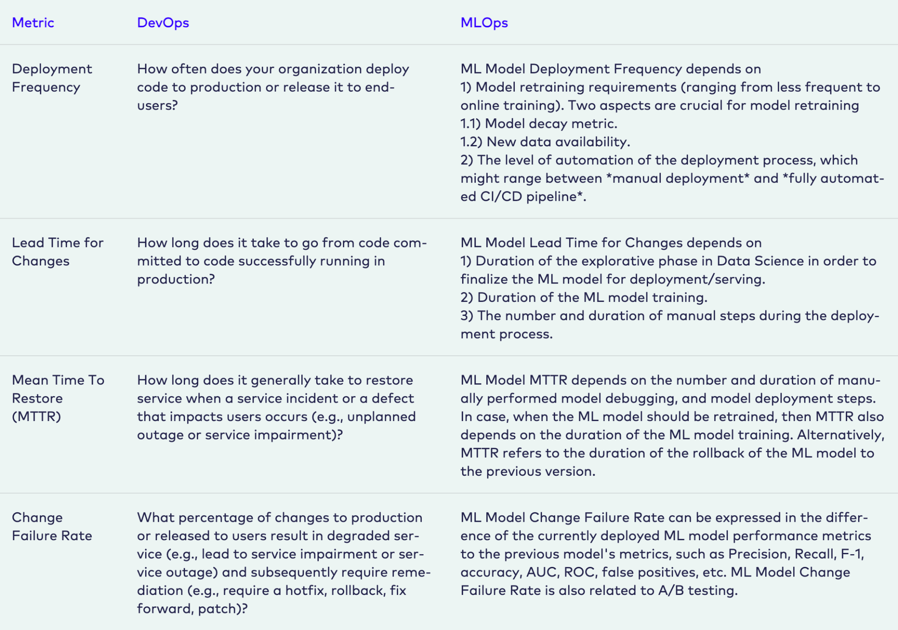
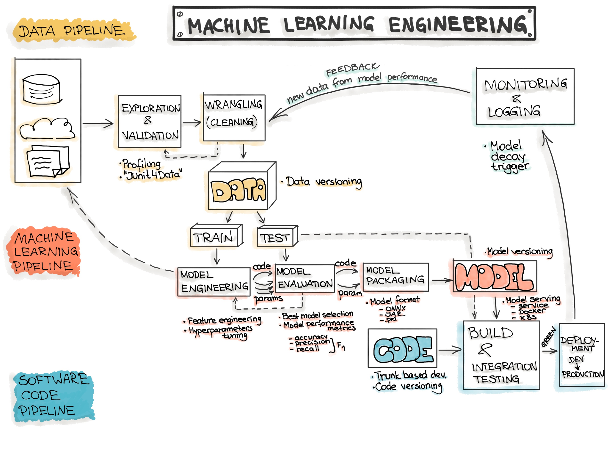

# DORA… for MLOps?

---

## MLOps?

The four DORA metrics were made for DevOps – software delivery in general. But we are running **machine learning** systems, which have more moving parts than a regular software project.

From https://ml-ops.org/content/mlops-principles

---

## More complex pipelines

Where a regular software project mostly deals with code, an ML system involves data and models too:

From https://ml-ops.org/content/end-to-end-ml-workflow

In the following sections we go through the four metrics one by one and discuss what they mean for an ML system.
