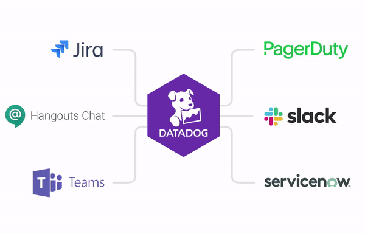
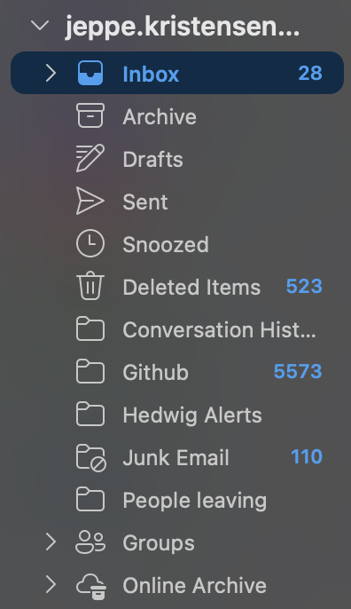

# Deployment Frequency: Logging

To even notice the issues from the previous pages – model decay, drift, outliers – you need data about your system in production.

---

## Log, monitor and alert for everything

Things worth logging, monitoring and setting up alerts for:

- Staleness of model
- Prediction quality
- Dev ↔ prod prediction mismatch
- Schema mismatches
- Numerical stability
- Computational performance
- Pipeline changes

Within reason, anyway.

This was my inbox 2 years ago. Now I don't even know how many Github notifications I have.

---

## Circling back to deployment frequency

It is nice to know your average deployment frequency.

But it depends on lots of things – your product, your users, your data cadence, your level of automation.

→ Deployment frequency is a **good relative goal**: compare against yourself over time, not against other teams.
